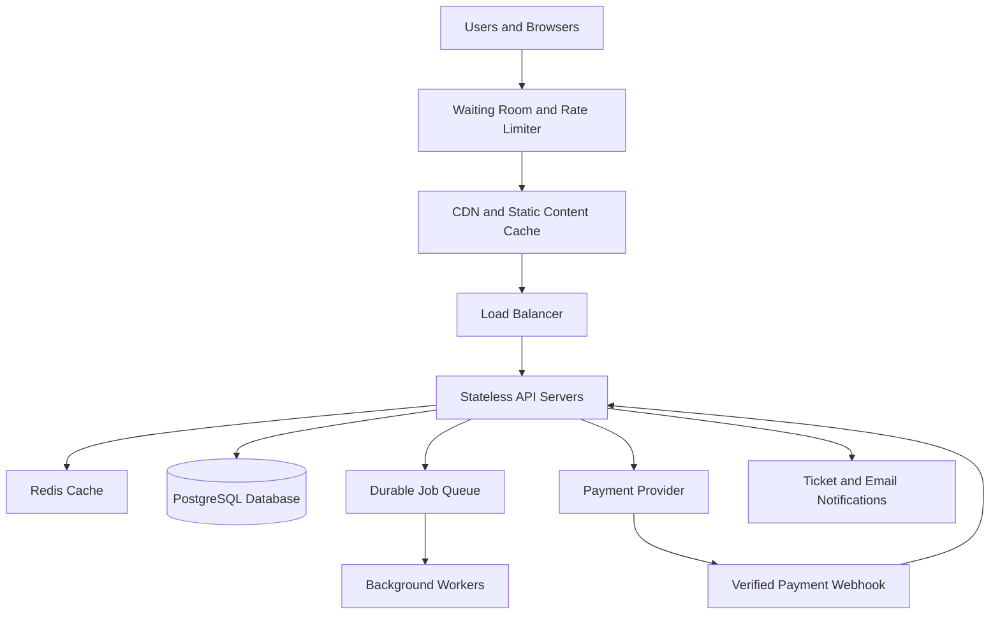

# TicketHub: Event Ticketing System Design

## 1. Requirements

TicketHub is a website where users can discover concerts and events, view available seats, reserve seats temporarily, pay for tickets, and access their purchased tickets. The system must remain responsive and prevent double-booking, even when demand is much greater than the number of available seats.

### 1.1 Functional requirements

1. Users can register, log in, and securely manage their accounts.
2. Users can browse, search, and filter events by name, date, venue, and location.
3. Users can view event details, ticket prices, and seat availability.
4. Users can select one or more available seats and hold them temporarily during checkout.
5. Users can pay for an order using a supported payment provider.
6. Users can view their order history and retrieve confirmed tickets.
7. Administrators can create events, configure seats and prices, and manage event status.
8. The system can expire abandoned holds and return eligible seats to the available pool.
9. The system can process payment notifications safely, including duplicate notifications and failed payments.
10. The system can notify customers when their orders are confirmed or when payment requires attention.

### 1.2 Non-functional requirements

**Performance**
- Event listings should normally load within 2 seconds.
- Seat availability should normally respond within 1 second under expected load.
- The system should handle a sudden increase in requests without allowing overload to corrupt seat or order data.

**Correctness and consistency**
- A seat must never be confirmed for two customers.
- A seat hold must have a clear owner and expiry time.
- Order totals must match the prices accepted at checkout.
- Repeated requests and payment callbacks must not create duplicate orders or charges.

**Fairness**
- Ticket sales should open at a published time.
- A waiting room should control admission during high-demand sales.
- The system should apply transparent queue rules, rate limits, and protections against automated abuse.
- No customer should gain unlimited priority by repeatedly refreshing or sending excessive requests.

**Availability and reliability**
- Browsing should remain available where possible during a sale.
- The system should degrade gracefully when demand exceeds capacity.
- Failed background jobs should be retried safely.
- The system should monitor errors, latency, database load, and payment failures.

**Security**
- Use HTTPS, secure password hashing, authentication, and role-based authorization.
- Validate input and protect against common web attacks.
- Verify payment-provider webhook signatures.
- Do not store raw payment-card details in TicketHub.

**Scalability and maintainability**
- Application servers should scale horizontally.
- Static content and non-critical event information should be cached.
- The database schema, APIs, and system architecture should be documented and tested.

## 2. Traffic and Capacity Estimates

These estimates are planning assumptions, not measurements from a running production system.

### 2.1 Normal-day traffic

Given:
- Registered users: 2,000,000.
- Daily visitors: 50,000.
- Page views per visitor: 10.
- Tickets sold per day: 5,000.

**Daily page views**

50,000 visitors × 10 page views = 500,000 page views per day.

**Average page views per second**

500,000 ÷ 86,400 seconds ≈ 5.8 page views per second.

Assume each page view causes an average of three backend API requests.

**Daily API requests**

500,000 × 3 = 1,500,000 requests per day.

**Average API request rate**

1,500,000 ÷ 86,400 ≈ 17.4 requests per second.

**Average ticket sales rate**

5,000 ÷ 86,400 ≈ 0.058 tickets per second.

These are daily averages. Actual traffic will vary by time of day and event popularity. I would initially plan to handle at least ten times the average normal API load, or approximately 175 requests per second, then validate this target with load tests.

### 2.2 Popular-concert sale

Given:
- 200,000 people attempt to buy tickets within 10 minutes.
- Only 20,000 seats are available.
- Ten minutes equals 600 seconds.

**Average incoming purchase attempts**

200,000 ÷ 600 ≈ 333 people per second.

**Demand compared with supply**

200,000 people ÷ 20,000 seats = 10 people per seat.

If every seat sells, at least 180,000 interested people will not obtain a seat.

Assuming three backend API requests per person:

200,000 × 3 = 600,000 API requests during the sale.

600,000 ÷ 600 = 1,000 API requests per second on average.

The real peak could be considerably higher because users may refresh pages, poll seat maps, retry requests, or browse multiple events.

I would use an initial planning target of approximately 2,000 API requests per second for this scenario, then adjust it through load testing and capacity measurements. This is a proposed target, not a guarantee of performance.

### 2.3 Comparison and response

The sale generates an estimated 1,000 API requests per second compared with the normal average of 17.4 requests per second.

1,000 ÷ 17.4 ≈ 57.5.

The average sale request rate is therefore approximately 57 times the normal average. The system must also prepare for short bursts above the ten-minute average.

To handle the spike, TicketHub will use a waiting room, rate limiting, a CDN, caching, horizontally scaled API servers, database connection pooling, and background workers for non-critical tasks. PostgreSQL will remain the authoritative source for seat ownership. Caching will improve performance but will never decide who owns a seat.

## 3. API Design

The API uses HTTPS and JSON. Protected endpoints require authentication and authorization. IDs shown below are examples.

| Method and endpoint | Purpose | Important behaviour |
|---|---|---|
| GET `/api/events` | Browse and search events | Supports filters, sorting, and pagination. |
| GET `/api/events/{eventId}` | View event details | Returns event information, venue, date, and ticket details. |
| GET `/api/events/{eventId}/seats` | View seats | Returns seat labels, prices, and availability. Availability may change immediately afterward. |
| POST `/api/holds` | Hold seats temporarily | Validates the requested seats and atomically holds them for a limited time. |
| DELETE `/api/holds/{holdId}` | Release a hold | Releases eligible seats held by the authenticated user. |
| POST `/api/orders` | Create an order from a hold | Verifies hold ownership and expiry, records prices, and uses an idempotency key. |
| POST `/api/orders/{orderId}/payment` | Initiate payment | Creates a payment request with the payment provider using an idempotency key. |
| POST `/api/payments/webhook` | Receive payment results | Verifies the provider signature and safely processes repeated notifications. |
| GET `/api/me/orders/{orderId}` | View order status | Returns order and payment status after checking ownership. |
| GET `/api/me/tickets` | View purchased tickets | Returns only tickets belonging to the authenticated user. |

### 3.1 Example seat-hold request

Request to `POST /api/holds`:

```json
{
  "eventId": "event-101",
  "seatIds": ["seat-A12", "seat-A13"]
}
```

If both seats are available, the server returns a hold ID and expiry time. If either seat is unavailable, the whole request fails without leaving only some of the requested seats held.

Example successful response:

```json
{
  "holdId": "hold-501",
  "status": "held",
  "expiresAt": "2026-10-13T19:30:00+03:00"
}
```

### 3.2 API error handling

- `200 OK`: Request completed successfully.
- `201 Created`: A hold or order was created.
- `400 Bad Request`: Input is invalid.
- `401 Unauthorized`: Authentication is required.
- `403 Forbidden`: The user is not allowed to access the resource.
- `404 Not Found`: The event, seat, hold, or order does not exist.
- `409 Conflict`: A seat is unavailable or a request conflicts with current state.
- `429 Too Many Requests`: The client has exceeded its rate limit.
- `503 Service Unavailable`: The system temporarily cannot accept the request.

Clients should use bounded retries with backoff for retryable failures. Payment and order-creation requests must use idempotency keys so retrying after a network interruption does not create duplicate operations.

## 4. Relational Data Model

TicketHub will use PostgreSQL because it supports relational constraints, transactions, row-level locking, and reliable concurrent updates.

### 4.1 Users table

| Column | Type | Constraint or purpose |
|---|---|---|
| user_id | UUID | Primary key |
| name | VARCHAR(100) | Required |
| email | VARCHAR(255) | Required and unique |
| password_hash | VARCHAR(255) | Required; stores a secure password hash |
| created_at | TIMESTAMP | Account creation time |

### 4.2 Events table

| Column | Type | Constraint or purpose |
|---|---|---|
| event_id | UUID | Primary key |
| name | VARCHAR(200) | Required |
| venue | VARCHAR(200) | Required |
| starts_at | TIMESTAMP | Event start time |
| sale_starts_at | TIMESTAMP | Scheduled sale opening |
| status | VARCHAR(30) | Draft, on sale, sold out, cancelled |

### 4.3 Seats table

Each row represents one sellable seat for one event. This event-specific model allows a physical seat to be sold separately for different events.

| Column | Type | Constraint or purpose |
|---|---|---|
| seat_id | UUID | Primary key |
| event_id | UUID | Foreign key referencing events(event_id) |
| seat_label | VARCHAR(20) | Seat label such as A-12 |
| price | DECIMAL(10,2) | Current advertised price |
| status | VARCHAR(20) | Available, held, or sold |
| hold_id | UUID | Nullable active hold identifier |
| hold_expires_at | TIMESTAMP | Nullable hold expiry |
| order_id | UUID | Nullable confirmed order reference |

Constraints:
- `UNIQUE(event_id, seat_label)` prevents duplicate seat labels within an event.
- `FOREIGN KEY(event_id)` ensures every seat belongs to an existing event.
- A check constraint should restrict status to valid values.
- Status and hold fields must be updated consistently within transactions.

### 4.4 Orders table

| Column | Type | Constraint or purpose |
|---|---|---|
| order_id | UUID | Primary key |
| user_id | UUID | Foreign key referencing users(user_id) |
| status | VARCHAR(30) | Pending, confirmed, cancelled, expired, refunded |
| total_amount | DECIMAL(10,2) | Amount agreed for the order |
| idempotency_key | VARCHAR(100) | Unique request key |
| created_at | TIMESTAMP | Order creation time |

The idempotency key prevents a retry from creating a second order for the same logical request. In a multi-user system, the uniqueness scope should be designed carefully, for example by enforcing uniqueness on the authenticated user and key together.

### 4.5 Order Items table

| Column | Type | Constraint or purpose |
|---|---|---|
| order_item_id | UUID | Primary key |
| order_id | UUID | Foreign key referencing orders(order_id) |
| seat_id | UUID | Foreign key referencing seats(seat_id) |
| price_paid | DECIMAL(10,2) | Price recorded at purchase |

Constraints:
- `FOREIGN KEY(order_id)` links each item to its order.
- `FOREIGN KEY(seat_id)` links each item to its seat.
- `UNIQUE(seat_id)` prevents a seat from being inserted into two order items.

This uniqueness rule assumes each row in `seats` represents one event-specific ticket and that each seat is sold only once for that event. Refunds and cancellations must follow explicit rules for whether a ticket can be returned to sale.

### 4.6 Payments table

| Column | Type | Constraint or purpose |
|---|---|---|
| payment_id | UUID | Primary key |
| order_id | UUID | Foreign key referencing orders(order_id) |
| provider_reference | VARCHAR(150) | Unique payment-provider reference |
| amount | DECIMAL(10,2) | Amount requested or charged |
| status | VARCHAR(30) | Pending, successful, failed, refunded |
| created_at | TIMESTAMP | Payment creation time |

The payment-provider reference must be unique so the same provider transaction cannot be recorded twice. Payment attempts should be tracked separately when an order is retried or a payment fails.

### 4.7 Relationships

- **Users to Orders:** One user can create many orders. Each order belongs to one user.
- **Events to Seats:** One event has many seats. Each seat belongs to one event.
- **Orders to Order Items:** One order can contain multiple seats through its order items.
- **Seats to Order Items:** Each seat can appear in at most one sold order item.
- **Orders to Payments:** One order can have multiple payment attempts, each belonging to one order.

The primary keys uniquely identify rows. Foreign keys protect relationships between tables. Unique constraints enforce business rules that must hold even if application code makes a mistake.

## 5. Preventing Double-Booking

The core business rule is that one seat can be sold to only one customer. TicketHub must enforce this rule in PostgreSQL, not merely in the user interface or Redis cache.

### 5.1 Atomic seat holds

When a user requests seats, the server performs the following steps:

1. Authenticate the user and validate the event and requested seat IDs.
2. Begin a database transaction.
3. Lock all requested seat rows in a consistent order using `SELECT ... FOR UPDATE`.
4. Check each locked seat's current status and hold expiry.
5. If every seat is available, or has a validly expired hold, assign the seats to the new hold and set a short expiry time, such as five minutes.
6. If any seat is unavailable, roll back the transaction so none of the requested seats remain partially held.
7. Commit only after the full selection has been updated successfully.

### 5.2 Example: two users request seat A-12 simultaneously

Suppose Alice and Brian attempt to hold the same seat at exactly the same time.

1. Alice's transaction obtains a row-level lock on A-12.
2. Brian's transaction tries to lock A-12 and must wait.
3. Alice checks that the seat is available, assigns it to her hold, and commits.
4. Brian obtains the lock after Alice's transaction finishes.
5. Brian sees that the seat is now held and receives `409 Conflict`.
6. Only Alice holds the seat. Brian cannot purchase it unless it becomes available again.

This works because the database serializes competing changes to the same row.

### 5.3 Example transaction

The following SQL is illustrative. Production code must validate the locked row, handle missing seats, and roll back when the requested seats cannot all be held.

```sql
BEGIN;

SELECT seat_id, status, hold_expires_at
FROM seats
WHERE seat_id = :seat_id
FOR UPDATE;

-- Application verifies that the seat is available
-- or that its previous hold has expired.
-- If not, ROLLBACK and return a conflict.

UPDATE seats
SET status = 'held',
    hold_id = :hold_id,
    hold_expires_at =
      CURRENT_TIMESTAMP + INTERVAL '5 minutes'
WHERE seat_id = :seat_id;

COMMIT;
```

For a multi-seat request, the application locks all requested rows in a consistent order and checks all of them before making the changes. If any seat cannot be held, the entire transaction is rolled back.

### 5.4 Isolation level and database constraints

PostgreSQL's default `READ COMMITTED` isolation level is sufficient for this pattern when row-level locks, fresh status checks, and constraints are used correctly. `SERIALIZABLE` isolation is another option, but it can abort transactions that must then be retried.

The database adds multiple layers of protection:

- Row-level locks serialize competing attempts to claim the same seat.
- Conditional updates and status checks ensure only eligible seats can be held.
- `UNIQUE(event_id, seat_label)` prevents duplicate seat records.
- `UNIQUE(order_items.seat_id)` prevents the same event-specific seat from being recorded in two sold order items.
- Foreign keys prevent orders and seats from referencing nonexistent records.

The application must not check availability before locking and then assume the result remains valid. Another user could claim the seat between the initial check and the update.

### 5.5 Payment and hold expiry

A hold is temporary, not a guarantee that payment has completed.

1. The server verifies that the hold belongs to the user and has not expired.
2. It creates an order and records the agreed seat prices.
3. It initiates payment with an idempotency key.
4. After a verified payment notification, a transaction checks that the order still owns the seats and that the seats have not been sold elsewhere.
5. The transaction marks the order confirmed and the seats sold, while preserving the unique constraints.
6. Repeated payment notifications are handled idempotently.

If payment succeeds after the hold has expired and the seats have already been reassigned, TicketHub must not confirm the conflicting order. It should follow a documented recovery process, such as refunding the payment or escalating it for resolution.

Expired holds can be released by background workers. However, new hold requests must check expiry themselves so that correctness does not depend on a cleanup job running on time.

## 6. Architecture Diagram and Components

### 6.1 Architecture diagram



### 6.2 Component explanations

**1. Users and browsers**

Customers use the website to discover events, view seats, reserve tickets, and pay for orders.

**2. Waiting room and rate limiter**

The waiting room controls how quickly customers enter a high-demand sale. It applies transparent admission rules and reduces sudden bursts. Rate limits prevent a single user or automated client from overwhelming the service.

**3. CDN and static content cache**

The content delivery network serves images, stylesheets, JavaScript, and other static assets. This reduces latency for users and prevents static downloads from consuming unnecessary application capacity.

**4. Load balancer**

The load balancer distributes requests across healthy API servers and removes unhealthy instances from rotation.

**5. Stateless API servers**

These servers authenticate users, validate input, enforce business rules, and coordinate database and payment operations. Since the servers do not rely on local session state, additional instances can be added during a sale.

**6. Redis cache**

Redis stores frequently requested event descriptions and other non-authoritative data. Cached seat availability can become stale, so every hold and purchase is verified against PostgreSQL.

**7. PostgreSQL database**

PostgreSQL stores users, events, seats, orders, order items, and payment records. Transactions, row-level locks, foreign keys, and unique constraints protect the correctness of seat ownership.

**8. Durable job queue and background workers**

The queue handles retryable background tasks, such as email notifications and hold-cleanup jobs. Critical seat ownership decisions are made synchronously in database transactions rather than relying on eventually consistent background processing.

**9. Payment provider and verified webhook**

The payment provider processes external payments and sends status notifications. TicketHub verifies webhook signatures, deduplicates notifications, and safely retries recoverable failures.

**10. Ticket and email notifications**

Notifications deliver order confirmations and ticket details. If an email fails, it can be retried without creating another order or cancelling an already confirmed purchase.

### 6.3 How the architecture handles the big sale

The waiting room smooths incoming traffic. The CDN and Redis reduce unnecessary database reads, and the load balancer distributes requests across horizontally scaled API servers.

Database connection pooling, optimized queries, short transactions, monitoring, and load tests help identify and control bottlenecks. Background workers process non-critical tasks separately so email delivery does not block checkout.

The database remains the final authority for seat ownership. Conflicting requests wait for a lock or receive a conflict response. If the system reaches capacity, it slows admission or returns retryable responses instead of bypassing the concurrency controls.

## 7. System Design Trade-offs

### Trade-off 1: Consistency versus throughput

Row-level locking and transactions protect seat ownership, but competing requests for popular seats may wait or fail with a conflict. This can reduce throughput. TicketHub prioritizes correctness over accepting every request immediately and uses a waiting room and short transactions to reduce contention.

### Trade-off 2: Hold duration versus fairness

Long holds give customers more time to pay but prevent other customers from accessing seats that may never be purchased. Short holds return abandoned seats more quickly but can frustrate users who need extra time. TicketHub starts with a five-minute hold, displays a countdown, and permits only carefully controlled extensions.

### Trade-off 3: Caching versus fresh data

Caching event information reduces latency and database load. However, cached seat availability can become outdated. TicketHub caches descriptions and static data aggressively but validates every seat hold and purchase against PostgreSQL.

### Trade-off 4: Waiting room versus immediate access

A waiting room protects the system and makes admission more orderly during a major sale, but users must wait before entering. TicketHub accepts this inconvenience during exceptional demand to improve stability and apply fair, published queue rules.

## Conclusion

TicketHub combines scalable application infrastructure with transactional data management. The waiting room, CDN, cache, and horizontal scaling improve performance during a major sale. PostgreSQL transactions, row-level locks, unique constraints, expiring holds, and idempotent payment processing protect data integrity.

The most important design principle is that **a seat is not considered sold merely because a user selected it or paid through an external provider. Seat ownership must be confirmed through a safe, atomic database workflow that never permits two customers to own the same seat.**