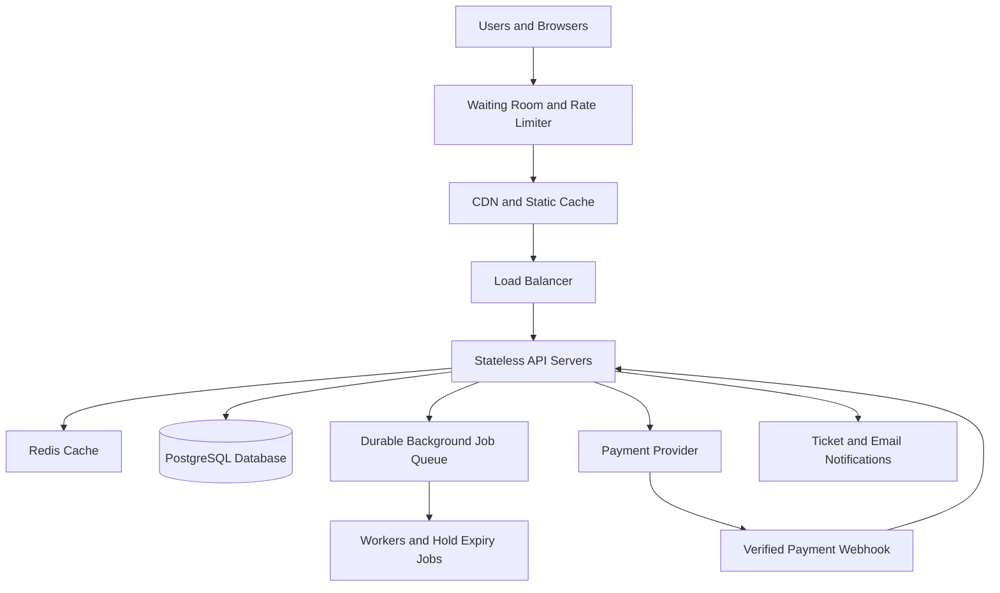

# TicketHub — System Design

## 1. Requirements

### Functional requirements

1. Users can register, log in, and manage their accounts.
2. Users can browse, search, and filter concerts and events by name, date, venue, and location.
3. Users can view event details, ticket prices, and real-time seat availability.
4. Users can select available seats and temporarily hold them while completing checkout.
5. Users can pay securely and receive confirmed tickets with unique ticket IDs.
6. Users can view their orders, tickets, and payment status.
7. Administrators can create events, configure venues and seats, set prices, and monitor sales.
8. The system can release expired seat holds and process payment confirmations safely.

### Non-functional requirements

- **Speed:** Event listings should normally load within 2 seconds, and seat availability should normally respond within 1 second under expected load.
- **Correctness:** A seat must never be confirmed for two different orders. Orders and payment records must remain consistent.
- **Fairness:** A sale should use a published opening time, rate limiting, and a fair queue or waiting room. Users should not gain an advantage by sending unlimited requests or repeatedly refreshing.
- **Availability:** Browsing should remain available during high traffic. If checkout becomes overloaded, the system should queue users rather than accept unsafe purchases.
- **Security:** Use authentication, authorization, HTTPS, input validation, secure payment-provider integration, and protection against automated abuse.
- **Scalability:** Application servers should scale horizontally to handle sudden increases in traffic.
- **Reliability:** Failed or repeated payment requests must not create duplicate charges or duplicate confirmed orders.
- **Maintainability:** Use documented APIs, clear service boundaries, monitoring, and automated tests.

## 2. Traffic and capacity estimates

The following are planning estimates, not measured production results.

### Normal-day traffic

Given:
- 2 million registered users.
- 50,000 visitors per day.
- 10 page views per visitor.
- 5,000 tickets sold per day.

Calculations:

- Daily page views = 50,000 × 10 = **500,000 page views**.
- Average page views per second = 500,000 ÷ 86,400 ≈ **5.8 page views/second**.
- Assuming 3 backend API requests per page view, daily API requests = 500,000 × 3 = **1.5 million requests**.
- Average API request rate = 1,500,000 ÷ 86,400 ≈ **17.4 requests/second**.
- Average ticket sales rate = 5,000 ÷ 86,400 ≈ **0.058 tickets/second**.

Actual traffic will fluctuate, so the system should support at least 10 times the average normal API rate, approximately 175 requests/second, without compromising correctness.

### Popular-concert sale

Given:
- 200,000 people attempt to buy tickets in 10 minutes.
- Only 20,000 seats are available.

Calculations:

- Purchase attempts per second = 200,000 ÷ 600 ≈ **333 people/second**.
- Demand-to-supply ratio = 200,000 ÷ 20,000 = **10:1**.
- At most 20,000 seats can be sold; at least 180,000 interested people cannot receive a seat if every seat is sold.
- If each person generates 3 API requests during the sale, this represents approximately 600,000 requests in 10 minutes, or **1,000 requests/second on average**. Refreshes, seat-map polling, and retries could increase the actual peak considerably.

The design should initially target around 2,000 API requests/second for this scenario, then validate and adjust the capacity through load testing.

### Comparison and response

The estimated sale traffic of 1,000 requests/second is about 57 times the normal average of 17.4 requests/second. A short burst can be higher than the ten-minute average.

To cope, TicketHub will use a waiting room, request rate limits, caching for event details, horizontally scaled application servers, a durable queue for selected background work, and database transactions for seat allocation. Cached data may serve event descriptions and images, but the database remains authoritative for seat ownership.

## 3. API design

All endpoints use HTTPS and JSON. Protected endpoints require authentication. Event and seat identifiers are examples of resource IDs.

| Method and endpoint | Purpose | Important behaviour |
|---|---|---|
| GET `/api/events` | Browse and search events | Supports search, date, location, and pagination filters. |
| GET `/api/events/{eventId}` | View event details | Returns venue, date, description, and ticket information. |
| GET `/api/events/{eventId}/seats` | View seats | Returns seat IDs, prices, and current availability. |
| POST `/api/holds` | Hold selected seats | Requires authentication; atomically reserves available seats for a short period, such as 5 minutes. |
| DELETE `/api/holds/{holdId}` | Release a hold | Releases the user's unpurchased seats when permitted. |
| POST `/api/orders` | Create an order from a valid hold | Verifies ownership, expiry, and seat prices; uses an idempotency key to avoid duplicate orders. |
| POST `/api/orders/{orderId}/payment` | Initiate payment | Creates a payment request with the payment provider and an idempotency key. |
| POST `/api/payments/webhook` | Receive payment updates | Verifies the provider's signature and safely processes repeated notifications. |
| GET `/api/me/tickets` | View the user's tickets | Returns tickets belonging only to the authenticated user. |
| GET `/api/me/orders/{orderId}` | View order status | Returns order details and payment status after an ownership check. |

### Example: holding seats

A request to `POST /api/holds` could contain:

```json
{
  "eventId": "event-101",
  "seatIds": ["A-12", "A-13"]
}
```

If both seats are available, the server returns a hold ID and expiry time. If either seat cannot be held, the request fails without partially reserving the selection.

Suggested status codes include `200` for successful reads, `201` for created resources, `400` for invalid input, `401` for unauthenticated requests, `409` for unavailable seats or conflicting reservations, and `429` for rate-limited requests.

## 4. Data model

Use a relational database such as PostgreSQL because seat allocation and order creation require transactions, foreign keys, and uniqueness constraints.

### Table 1: users

| Column | Description |
|---|---|
| `user_id` | Primary key |
| `name` | User's display name |
| `email` | Required; unique |
| `password_hash` | Secure password hash |
| `created_at` | Account creation timestamp |

### Table 2: events

| Column | Description |
|---|---|
| `event_id` | Primary key |
| `name` | Event name |
| `venue` | Venue name or reference |
| `starts_at` | Event start timestamp |
| `sale_starts_at` | Scheduled ticket-sale opening |
| `status` | Draft, on sale, sold out, or cancelled |

### Table 3: seats

Each row represents a seat for a specific event. This design can be extended to separate reusable venue seats from event-specific seat inventory.

| Column | Description |
|---|---|
| `seat_id` | Primary key |
| `event_id` | Foreign key referencing `events.event_id` |
| `seat_label` | Seat identifier, such as A-12 |
| `price` | Ticket price |
| `status` | Available, held, or sold |
| `hold_id` | Nullable reference to the active hold |
| `hold_expires_at` | Nullable expiry timestamp |
| `order_id` | Nullable reference to the confirmed order |

Add a unique constraint on `(event_id, seat_label)` so the same seat label cannot be created twice for an event. Seat status and ownership must be updated transactionally.

### Table 4: orders

| Column | Description |
|---|---|
| `order_id` | Primary key |
| `user_id` | Foreign key referencing `users.user_id` |
| `status` | Pending, confirmed, expired, cancelled, or refunded |
| `total_amount` | Total amount payable |
| `idempotency_key` | Unique key for the user's order-creation request |
| `created_at` | Order creation timestamp |

### Table 5: order_items

| Column | Description |
|---|---|
| `order_item_id` | Primary key |
| `order_id` | Foreign key referencing `orders.order_id` |
| `seat_id` | Foreign key referencing `seats.seat_id` |
| `price_paid` | Price captured when the order is confirmed |

Add a unique constraint on `seat_id` in `order_items` if each event-specific seat can be sold only once. This is an additional database-level safeguard against duplicate sales.

### Table 6: payments

| Column | Description |
|---|---|
| `payment_id` | Primary key |
| `order_id` | Foreign key referencing `orders.order_id` |
| `provider_reference` | Unique payment-provider transaction reference |
| `amount` | Amount charged |
| `status` | Pending, successful, failed, or refunded |
| `created_at` | Payment creation timestamp |

### Relationships

- One user can create many orders: `users 1 → many orders`.
- One event has many seats: `events 1 → many seats`.
- One order contains one or more order items: `orders 1 → many order_items`.
- Each order item references one seat; a seat can appear in only one successfully sold order item.
- An order can have payment attempts or payment records, depending on the payment-provider workflow. Each payment references one order.

## 5. Preventing two people from buying the same seat

The database, rather than the user interface or cache, must make the final decision about seat ownership.

### Seat-hold process

1. The user selects one or more seats.
2. The server begins a database transaction.
3. It locks the requested seat rows in a consistent order, or performs an atomic conditional update.
4. It checks that every seat is available or has a genuinely expired hold.
5. If every seat qualifies, it assigns all selected seats to the same hold and sets an expiry time, such as five minutes.
6. It commits the transaction. If any seat is unavailable, it rolls back the entire transaction.

For example, a conditional update can claim a seat only if it is available or its hold has expired. The database must ensure that concurrent requests cannot both successfully claim the same row. A row lock with a fresh status check is another valid approach.

### Checkout and payment

- The user can purchase only seats belonging to their valid hold.
- Order creation verifies the hold owner, expiry, seat prices, and seat status inside a transaction.
- Unique constraints provide a final safeguard even if application logic has a bug.
- The system uses idempotency keys so retries do not create duplicate orders or payment requests.
- A payment callback must be verified and processed idempotently.
- Seat holds expire automatically if checkout is abandoned. A background worker can clean them up, but the hold-expiry check must also occur during allocation so delayed cleanup cannot make an expired seat appear unavailable forever.

**Important payment rule:** A successful payment notification must not blindly sell a seat that has already been reassigned. The system must use a defined payment state machine and atomic order/seat transitions. If payment succeeds after a hold has expired and the seats have been reassigned, the system must not double-book them; it should follow a safe compensation process, such as refunding the payment or escalating the order for resolution.

This combination of transactions, conditional updates, row locking, uniqueness constraints, and idempotent payment processing protects correctness during concurrent requests.

## 6. Architecture diagram and components



### Component explanations

1. **Users and browsers:** Browse events, select seats, check out, and view purchased tickets.
2. **Waiting room and rate limiter:** Controls the number of users entering the sale, limits repeated requests, and reduces automated abuse. Queue admission should follow published rules rather than arbitrary user preference.
3. **CDN and static cache:** Serves images, scripts, stylesheets, and other static content without sending every request to the application servers.
4. **Load balancer:** Distributes requests across healthy API servers and removes unhealthy instances from service.
5. **Stateless API servers:** Validate requests, authenticate users, apply business rules, and coordinate database and payment operations. Additional instances can be started during a sale.
6. **Redis cache:** Stores frequently requested event descriptions and other non-authoritative data. It must never be the sole protection against double-booking.
7. **PostgreSQL:** Stores users, events, seats, orders, and payments. Transactions, locks, foreign keys, and unique constraints protect data integrity.
8. **Durable background job queue:** Handles asynchronous work such as email notifications and selected retryable tasks. Critical seat allocation must not be deferred to an eventually consistent job.
9. **Workers:** Process background jobs and expire stale holds. Database checks still enforce expiry during checkout and new holds.
10. **Payment provider and webhook:** Process payments externally and notify TicketHub of results. Webhooks must be authenticated, deduplicated, and safely retried.
11. **Ticket and email notifications:** Send confirmations after the order is confirmed. Notification failure must not undo a valid purchase.

### How the architecture survives the big sale

The waiting room limits how quickly requests reach the API and can distribute admission over time. The CDN handles static traffic, cached event details reduce repeated database reads, and stateless API servers scale horizontally. Rate limits and monitoring help detect overload.

The database remains the final authority for seat availability. Seat claims use short transactions and row-level locking or conditional updates. Requests that conflict receive a clear response rather than selling the same seat twice. Connection pooling, query optimization, load testing, alerts, and database capacity planning help prevent bottlenecks. Background jobs handle non-critical work, while payment operations use idempotency and recovery procedures.

If capacity is exceeded, the system should slow admission or return a retryable response instead of bypassing database safety controls.

## 7. Trade-offs

### Trade-off 1: Strict consistency versus throughput

Using PostgreSQL transactions and row locks protects seat correctness, but concurrent requests for the same popular seats may wait or fail with a conflict. This can reduce throughput during a very popular sale. TicketHub prioritizes correct seat ownership over accepting every purchase request immediately. A waiting room and efficient transactions reduce contention.

### Trade-off 2: Short seat holds versus user convenience

Short holds improve fairness by returning abandoned seats to the available pool quickly. However, a user who needs extra time to complete payment may lose a seat. A five-minute hold is a starting point; the system should clearly show the countdown and consider controlled extensions without allowing users to hold seats indefinitely.

### Trade-off 3: Caching versus fresh availability

Caching event descriptions and static content improves response times and reduces database load. Caching seat availability can display stale information, confusing users during a sale. Therefore, TicketHub may cache seat-map presentation briefly, but every hold and purchase must be validated against the authoritative database.

### Trade-off 4: Waiting room versus immediate access

A waiting room protects the backend from sudden spikes and can apply fair admission rules, but it makes some users wait before shopping. TicketHub accepts this inconvenience during high-demand sales to maintain stability and give eligible users a more orderly process.

## Conclusion

TicketHub combines scalable web infrastructure with transactional database design. Caching and horizontal scaling improve performance, while database constraints, atomic seat holds, idempotency, and safe payment recovery protect the most important business rule: one seat can be sold to only one customer.